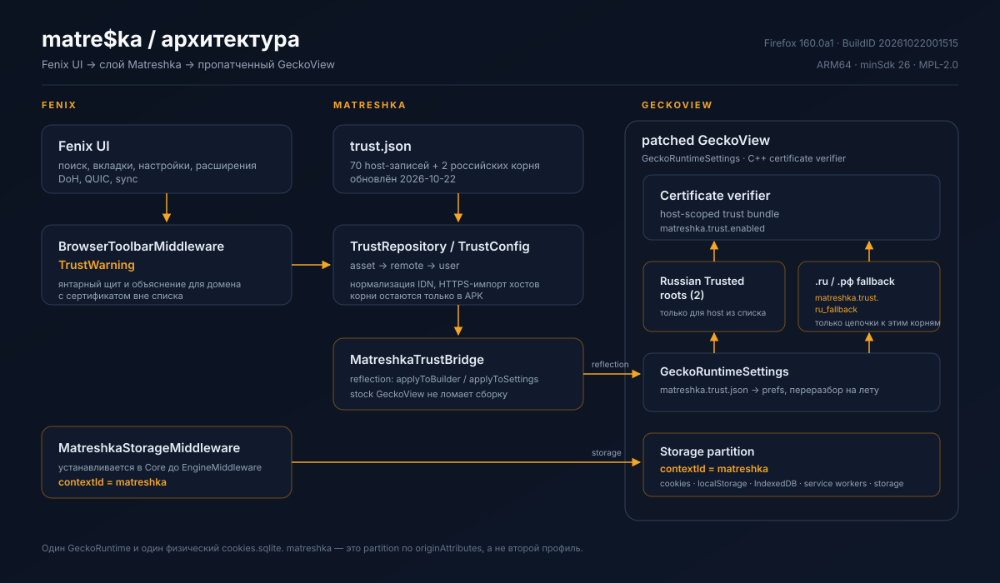

<div align="center">
  
  <h1>Matreshka Browser</h1>
  <p><strong>Инженерный форк Firefox (Fenix) для Android, реализующий принцип наименьших привилегий (Least Privilege) при работе с национальными цепочками доверия.</strong></p>
  <p>Браузер обеспечивает изолированную работу с российскими веб-ресурсами и минимизирует площадь атаки (Attack Surface Reduction) за счёт строгого ограничения области действия корневых сертификатов.</p>
  <p>Fenix / Firefox 160.0a1 · v0.2.0 · ARM64 · открытый патч-стек</p>
  <p>
    
    
    
    
  </p>
  <p>
    <a href="https://github.com/PuFFeG/matreshka-browser/releases/latest">
      
    </a>
  </p>
</div>

> **Независимый проект.** Matreshka Browser не связан с Mozilla и не одобрен ею. Иллюстрации созданы с помощью ИИ и не являются скриншотами приложения. Используйте код с осторожностью.

## О проекте

Matreshka Browser — форк Fenix с открытым патч-стеком для работы с цепочками доверия Russian Trusted. Дополнительное доверие включается для явно перечисленных хостов, а корневые сертификаты и базовый список поставляются в APK и не устанавливаются в системное хранилище Android. Для `.ru`/`.рф` есть отдельный fallback, который можно отключить.

Проект не подменяет TLS и не использует прокси. Он сохраняет возможности Fenix: вкладки, историю, закладки, поиск, расширения, настройки, DoH и QUIC. Для новых вкладок на российских хостах используется отдельный storage-контекст, но это не второй профиль и не изоляция всего трафика.

## Возможности

|  |  |  |
| :---: | :---: | :---: |
| **Доверие по списку.** Дополнительное доверие включается только для явно перечисленных хостов. Корни и базовый список поставляются в APK; удалённое обновление по HTTPS добавляет лишь хосты. | **Понятное предупреждение.** Янтарный индикатор показывает домен вне списка или устаревший список; он не оценивает репутацию сайта. | **Отдельный контекст.** Новые вкладки на хостах российского trust-слоя получают `contextId=matreshka`. Это разделение внутри одного GeckoRuntime. |

Для доменов `.ru` и `.рф` действует ограниченный fallback: цепочка всё равно должна сходиться к одному из двух встроенных корней. Удалённый список не может добавлять корневые сертификаты.

**Возможности Fenix:** поиск, настройки, история, закладки, расширения, синхронизация и DoH. QUIC/HTTP/3 включён; автоматический переводной pop-up по умолчанию выключен.

Файл [social-preview.png](docs/images/social-preview.png) предназначен для поля **Social preview** в настройках репозитория GitHub.

## Архитектура

Слой Matreshka не использует прокси и не подменяет TLS. Он добавляет host-scoped правила доверия и назначает отдельный storage-контекст вкладкам при создании.

[](docs/architecture.svg)

1. Fenix предоставляет интерфейс браузера.
2. `TrustRepository` объединяет встроенный, удалённый и пользовательский списки.
3. `MatreshkaTrustBridge` передаёт конфигурацию в GeckoView.
4. Патч GeckoView применяет правила доверия при проверке цепочки сертификатов.
5. `MatreshkaStorageMiddleware` назначает контекст новым вкладкам до создания `GeckoSession`.

<details>
<summary>Технические детали</summary>

- Конфигурация передаётся компактным текстовым bundle: список хостов и сертификаты в DER, закодированные Base64.
- В ядре используются prefs `matreshka.trust.enabled`, `matreshka.trust.ru_fallback` и `matreshka.trust.json`.
- Bundled-сертификат может стать trust anchor только при совпадении DER и если сертификат является CA.
- Обновление `matreshka.trust.json` перечитывается без пересборки GeckoView.
- Список считается устаревшим через 60 дней после `updatedAt`; срок действия промежуточного CA проверяется отдельно.

</details>

## Границы изоляции

`contextId=matreshka` — разделение данных внутри одного `GeckoRuntime`, а не отдельный профиль или процесс.

| Данные | Разделение |
| --- | --- |
| Cookies | Строки разделяются через `originAttributes`; файл `cookies.sqlite` общий |
| localStorage, IndexedDB, service workers | Отдельные storage-директории и partition |
| HTTP cache, permissions, профиль | Общие |
| Вкладка | Контекст задаётся при создании `GeckoSession` |

Вкладка, созданная в обычном контексте и позже перешедшая на российский хост, сохраняет исходный контекст. Custom tabs не партиционируются; private tabs используют private storage.

## Установка

- [Страница релизов](https://github.com/PuFFeG/matreshka-browser/releases)

Релиз `v0.2.0`: [ARM64 APK](https://github.com/PuFFeG/matreshka-browser/releases/download/v0.2.0/matreshka-browser-0.2.0-arm64-v8a-release.apk) · [SHA256SUMS](https://github.com/PuFFeG/matreshka-browser/releases/download/v0.2.0/SHA256SUMS). Скачивайте оба файла только со страницы [GitHub Releases](https://github.com/PuFFeG/matreshka-browser/releases/latest).

| Параметр | Значение |
| --- | --- |
| Название | `matreshka-browser` |
| Версия | `0.2.0` |
| Android | 8.0+ (`minSdk 26`) |
| ABI | `arm64-v8a` |
| Package | `ru.matreshka.browser` |
| База | Firefox/Fenix `160.0a1`, BuildID `20261022001515` |
| Лицензия | MPL-2.0 |

Перед установкой проверьте подпись APK и контрольную сумму из того же релиза:

```sh
apksigner verify --print-certs matreshka-browser-0.2.0-arm64-v8a-release.apk
sha256sum -c SHA256SUMS
```

Fingerprint сертификата подписи релиза: `D697BD505F67DA0B36B46F15583CCD851FB0153BB1C15986F529B7B7209C655C`. Это отпечаток сертификата, а не контрольная сумма APK. Устанавливайте сборки только из официального репозитория проекта.

## Сборка

Требуется дерево Firefox `160.0a1` с `mobile/android/fenix`, JDK 17 и Android SDK/NDK, Rust и Python, настроенные через `./mach bootstrap`.

```sh
export FIREFOX_SRC="$HOME/src/firefox"
export JAVA_HOME="$HOME/.mozbuild/jdk/jdk-17.0.20.1+1"

./scripts/apply.sh "$FIREFOX_SRC"
MOZCONFIG="$FIREFOX_SRC/mozconfig-arm64" ./scripts/build-release.sh "$FIREFOX_SRC"
```

Для подписания задайте локальные переменные `MATRESHKA_KEYSTORE` и `MATRESHKA_KEYSTORE_PASSWORD_FILE`, затем выполните:

```sh
./scripts/sign-apk.sh \
  "$FIREFOX_SRC/obj-aarch64-unknown-linux-android/gradle/build/mobile/android/fenix/app/outputs/apk/release/fenix-arm64-v8a-release.apk" \
  "dist/matreshka-browser-0.2.0-arm64-v8a-release.apk"
```

Либо запустите полный цикл сборки и подготовки релиза:

```sh
VERSION=0.2.0 FIREFOX_SRC="$FIREFOX_SRC" ./scripts/release.sh
```

Для изменённого C++-кода GeckoView требуется полная сборка, не artifact mode. Ключ подписи хранится локально и не входит в репозиторий; его потеря помешает устанавливать обновления поверх текущей сборки. Дополнительные сведения — в [fenix/README.md](fenix/README.md).

## Безопасность и ограничения

- Проект не обеспечивает анонимность и не заменяет VPN или Tor.
- Fallback ограничен доменами `.ru` и `.рф` и встроенными корнями; корректность правил и набора хостов требует независимой проверки.
- Янтарный индикатор отражает состояние доверия и списка, но не гарантирует отсутствие атаки или вредоносного сайта.
- Патч не добавляет поддержку GOST TLS.
- Удалённый список не может обновлять корневые сертификаты. Они обновляются только вместе с APK.
- Storage-контекст не разделяет HTTP cache, permissions и другие данные из таблицы выше.
- APK пока устанавливается и обновляется вручную. Сборка ARM64 проверена на устройстве.
- В релизе могут оставаться компоненты телеметрии и строки/иконки Mozilla; сверяйтесь с исходниками и конфигурацией конкретной сборки.

Сообщения об уязвимостях и проблемах безопасности направляйте владельцам репозитория приватным способом, если такой канал указан в настройках проекта.

## Лицензия и товарные знаки

Проект распространяется по [Mozilla Public License 2.0](LICENSE). Для распространения изменённого APK соблюдайте требования MPL-2.0 к исходникам изменённых файлов.

Mozilla, Firefox и соответствующие логотипы — товарные знаки Mozilla Foundation. Упоминание Firefox описывает базу проекта и не означает одобрения Mozilla.

## Разработка проекта

Патч ядра находится в `patches/core/matreshka-trust.patch`; изменения Fenix — в `fenix/files/`. Перед обновлением базы проверьте применимость патча, соберите ARM64-релиз и протестируйте сценарии доверия, предупреждения и хранения данных.
